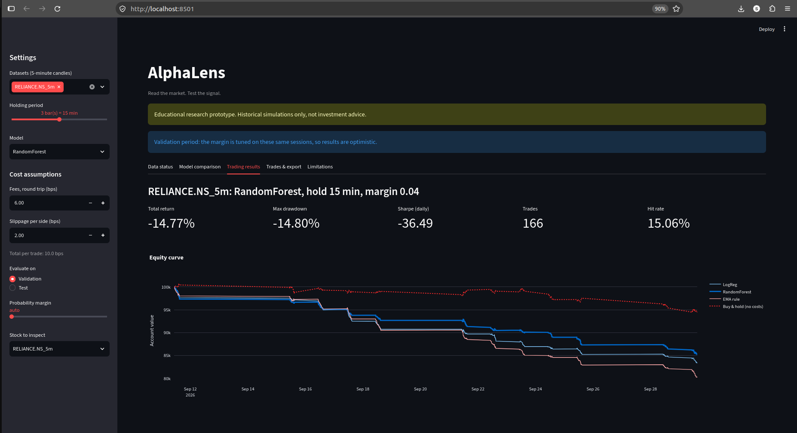
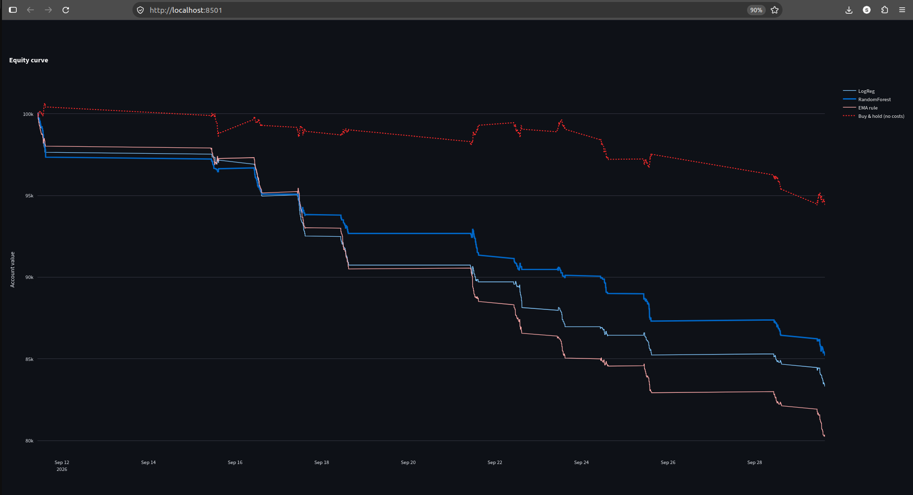
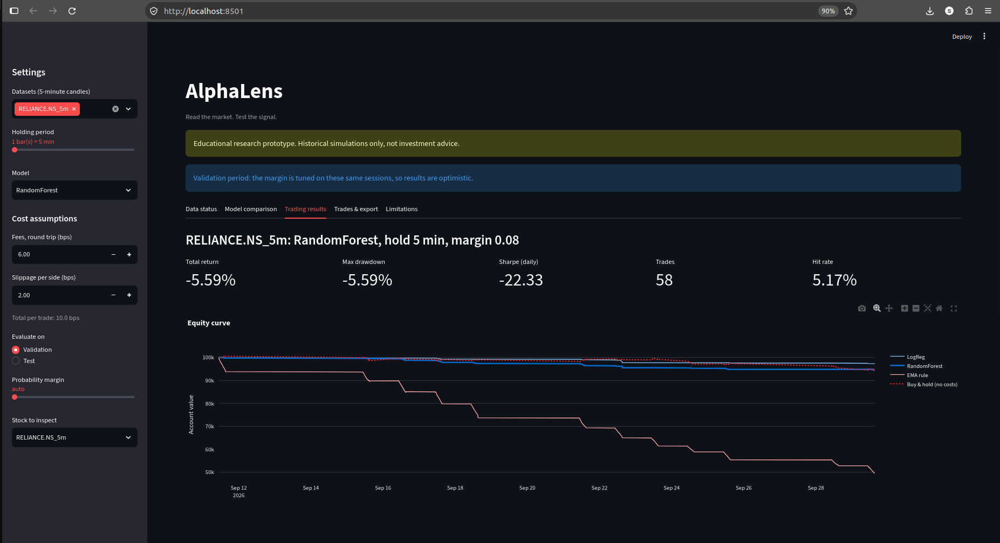

# AlphaLens

**Read the market. Test the signal.**

An educational research prototype that tests whether machine-learning models can find a tradable pattern in 5-minute NSE stock data, once realistic trading costs are included. It is not financial advice and does not trade real money.

> **Headline result:** on the untouched test period, no model or holding period made money after costs. Both models showed no reliable edge, and buy-and-hold beat every strategy. The value of this project is the leakage-controlled, cost-aware method, not a trading signal.

## Problem and intended user

Intraday traders often rely on indicators such as EMA and RSI, but a chart alone does not show whether a pattern generalizes or survives trading costs. AlphaLens gives students and researchers a reproducible way to test one clearly stated hypothesis on historical data.

**Research question:** can a model trained on past intraday features beat a simple rule-based baseline on later, unseen sessions after estimated transaction costs?

## Data

- **Source:** Yahoo Finance via `yfinance`, 5-minute candles (Open, High, Low, Close, Volume), symbols `RELIANCE.NS` and `TCS.NS`. `^NSEI` (Nifty 50) was downloaded and validated but not modelled, because index data has no volume.
- **Period:** 60 trading sessions, 2026-07-23 to 2026-10-16 (09:15 to 15:25 IST bars).
- **Quality checks** (`src/data_loader.py`): no duplicate timestamps, no missing values, no inconsistent OHLC rows. Each stock has 6 short gaps (10 to 15 minutes) inside trading days. Signals that would depend on a gap are dropped.
- **Known quirks:** the 09:15 bar often shows zero volume on Yahoo. The first 14 bars of each session are skipped for indicator warm-up anyway.
- **Licence and reuse:** Yahoo Finance data is for personal use, so raw data is not committed to this repository (`data/` is git-ignored). NSE's official historical intraday data is sold through NSE Data & Analytics under licence terms, so it was not used.
- **Reproducibility caveat:** Yahoo serves only about the last 60 days of 5-minute data. Re-running the download later gives a different window, so numbers will not match exactly. The results below come from the snapshot taken on 2026-10-16.

## Method

**Features** (computed only from bars up to and including bar *t*, inside each session): 1, 3 and 6-bar returns, close-to-EMA9 and close-to-EMA20 ratios, 14-bar RSI, 12-bar rolling volatility, minute of day, and relative volume.

**Target and trade convention**
- Signal at the close of bar *t*.
- Entry at the open of bar *t+1*.
- Exit at the close of bar *t+h*, where the holding period *h* is 1, 3 or 6 bars (5, 15 or 30 minutes).
- Label: 1 if that trade's return is positive, otherwise 0.
- No position is held overnight. The last bar of each session never produces a signal.
- One position at a time. Signals arriving while a trade is open are skipped.

**Split** (chronological, by whole sessions, never shuffled):

| Period | Dates | Rows (5-minute hold, both stocks) |
|---|---|---|
| Train | 2026-07-23 to 2026-09-10 | 4,191 |
| Validation | 2026-09-11 to 2026-09-29 | 1,389 |
| Test | 2026-09-30 to 2026-10-16 | 1,358 |

**Models:** Logistic Regression (with standard scaling fitted on training data only) and Random Forest (200 trees, max depth 5, min 50 samples per leaf, fixed seed). Both are small on purpose.

**Trading rule:** go long if the predicted probability of "up" is above the training base rate plus a margin, short if below it minus the margin, otherwise stay flat. The margin (0.02 to 0.10) was chosen on the validation period only, requiring at least 30 validation trades.

**Backtest assumptions**
- Costs: 10 bps (0.10%) per trade, made up of 6 bps fees round trip plus 2 bps slippage per side. These are placeholder assumptions, not exact broker rates. Taxes, bid-ask spread, market impact and liquidity limits are not modelled in detail.
- Short selling is assumed possible intraday.
- Position size: the whole account on each trade, starting from 100,000, compounding.
- Sharpe ratio: computed on daily returns and annualized with the square root of 252. With only about 12 test sessions it is not statistically meaningful.

**Benchmarks:** (1) an EMA rule that goes long when EMA9 is above EMA20 and short otherwise, traded every bar with the same costs; (2) buy-and-hold from the first to the last test bar, held overnight, with no costs.

**Leakage controls:** features use only past data; the target is built from later bars; preprocessing is fitted on training data only; splits cut between whole sessions; the test period was run once per holding period after the code was frozen (git tag `frozen-before-test`).

## Results

### Classification (validation, 5-minute hold)

| Model | Accuracy | Precision | Recall | F1 |
|---|---|---|---|---|
| Always predict "not up" (baseline) | 0.574 | n/a | n/a | n/a |
| Logistic Regression | 0.574 | 0.500 | 0.024 | 0.045 |
| Random Forest | 0.569 | 0.471 | 0.095 | 0.158 |

Only about 43% of validation bars are "up", so a model that always says "not up" scores 57.4%. Neither model beat that. Accuracy is not profitability, which is why the cost-aware backtest below is the real test.

### Backtest on the untouched test period (total return after costs; trades in brackets)

| Hold | Stock | Logistic Regression | Random Forest | EMA rule | Buy & hold |
|---|---|---|---|---|---|
| 5 min | RELIANCE | -7.06% (88) | -33.88% (404) | -50.06% | +1.35% |
| 5 min | TCS | -15.39% (160) | -34.39% (396) | -47.91% | +17.65% |
| 15 min | RELIANCE | -11.67% (165) | -13.34% (186) | -20.99% | +1.21% |
| 15 min | TCS | -21.57% (179) | -20.61% (183) | -18.62% | +17.76% |
| 30 min | RELIANCE | -2.46% (53) | -0.04% (19) | -10.09% | +1.36% |
| 30 min | TCS | -10.17% (58) | -0.91% (15) | -11.02% | +17.35% |

Full output is saved in `docs/final_hold1.txt`, `docs/final_hold3.txt` and `docs/final_hold6.txt`. All three holding periods are reported, with none selected after seeing test results.

### Interpretation

- Every strategy lost money after costs, and buy-and-hold was better in all six cases. The market rose during the test window, and the buy-and-hold comparison is not like-for-like: it holds overnight and pays no costs.
- Before costs, the average gain per trade was within a few basis points of zero in most cases, and its sign differed between the two stocks. A real signal would be positive on both.
- Longer holds lose less mainly because they trade less and pay less cost, not because predictions improved.
- The 30-minute Random Forest came closest to break-even, but on only 15 and 19 trades. Its apparent strength on validation did not hold on the test period, so it should be treated as noise.

## Limitations

- Short sample: about three months, one market phase, two stocks, and about 12 test sessions.
- Costs are assumptions, and real execution would differ.
- The margin and holding periods were explored on validation data, and several combinations were tried. Reporting all of them reduces, but does not remove, selection effects.
- Results are historical simulations. They say nothing about future performance.
- Feature importance is not reported and would not show causation if it were.

## Repository layout

```
src/data_loader.py     load, clean and validate OHLCV data
src/features.py        past-only features and the target
src/train.py           chronological split and models
src/evaluate.py        classification metrics
src/backtest.py        trades, costs, equity curve, risk metrics, benchmarks
src/run_pipeline.py    train both models and print classification metrics
src/run_backtest.py    cost-aware backtest (--hold 1|3|6, --final for the test period)
src/probe_data.py      download and sanity-check Yahoo data
tests/                 unit tests
docs/                  saved final test outputs
```

## Setup and run

```bash
git clone https://github.com/sahilkhojare/AlphaLens.git
cd AlphaLens
python3 -m venv .venv
source .venv/bin/activate
pip install -r requirements.txt

python src/probe_data.py                                   # downloads data into data/
python -m src.run_pipeline data/RELIANCE.NS_5m.csv data/TCS.NS_5m.csv
python -m src.run_backtest data/RELIANCE.NS_5m.csv data/TCS.NS_5m.csv --hold 3
python -m pytest -q
```

On Windows PowerShell, activate the environment with `.\.venv\Scripts\Activate.ps1`.

   ## Dashboard

   Run it with `streamlit run app.py`. The sidebar sets the datasets, holding period, model and cost assumptions. Tabs show data checks, model metrics, equity curves with benchmarks, a trades table with CSV download, and the limitations.

   
   
   

## Disclaimer

AlphaLens is an educational research prototype. Nothing here is investment advice, and no result should be used to make real trading decisions.